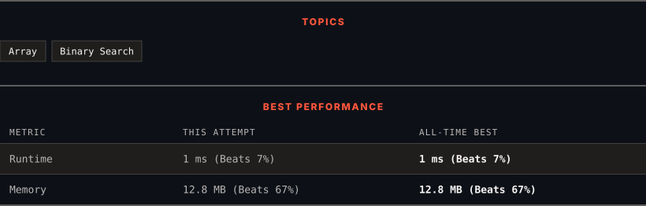

<div align="center">

# 35. Search Insert Position

      

[](https://leetcode.com/problems/search-insert-position/)

</div>

---

<div align="center">

<picture>
  <source media="(prefers-color-scheme: dark)" srcset="panel-dark.svg">
  <source media="(prefers-color-scheme: light)" srcset="panel-light.svg">
  
</picture>

</div>

### HOW IT WENT

| | |
|:--|:--|
| **Attempts** | 2 before accepted |
| **Time to solve** | 32 min |
| **Verdicts** | ✅ Accepted → ✅ Accepted |

---

### NOTES

_No notes yet._

---

### SOLUTIONS (2)

| # | File | Language | Date |
|:-:|------|:--------:|:----:|
| 1 | [sol1.py](./sol1.py) | `Python` | 2026-10-14 |
| 2 | [sol2.py](./sol2.py) | `Python` | 2026-10-14 ← **latest** |

---

### PROBLEM DESCRIPTION

Given a sorted array of distinct integers and a target value, return the index if the target is found. If not, return the index where it would be if it were inserted in order.

You must write an algorithm with `O(log n)` runtime complexity.

 

**Example 1:**

```

**Input:** nums = [1,3,5,6], target = 5
**Output:** 2

```

**Example 2:**

```

**Input:** nums = [1,3,5,6], target = 2
**Output:** 1

```

**Example 3:**

```

**Input:** nums = [1,3,5,6], target = 7
**Output:** 4

```

 

**Constraints:**

	- `1 <= nums.length <= 10^4`

	- `-10^4 <= nums[i] <= 10^4`

	- `nums` contains **distinct** values sorted in **ascending** order.

	- `-10^4 <= target <= 10^4`

---

<div align="center">

<sub>Auto-synced by <strong>LeetSync</strong> · Built by <a href="https://deveshsamant.in/">Devesh Samant</a></sub>

</div>
