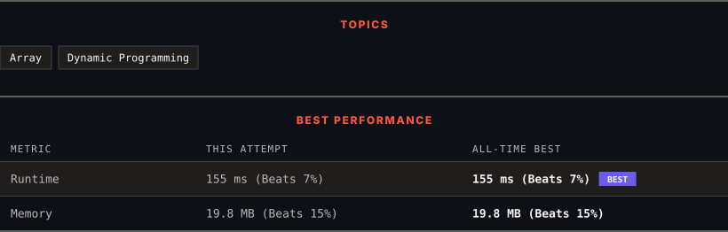

<div align="center">

# 121. Best Time to Buy and Sell Stock

      

[](https://leetcode.com/problems/best-time-to-buy-and-sell-stock/)

</div>

---

<div align="center">

<picture>
  <source media="(prefers-color-scheme: dark)" srcset="panel-dark.svg">
  <source media="(prefers-color-scheme: light)" srcset="panel-light.svg">
  
</picture>

</div>

> **New personal best** — Runtime improved on this submission.

### HOW IT WENT

| | |
|:--|:--|
| **Attempts** | 3 before accepted |
| **Time to solve** | 44 h 19 min |
| **Verdicts** | ❌ Wrong Answer → ❌ Wrong Answer → ✅ Accepted |

---

### NOTES

_No notes yet._

---

### SOLUTIONS (1)

| # | File | Language | Date |
|:-:|------|:--------:|:----:|
| 1 | [sol1.py](./sol1.py) | `Python` | 2026-10-13 ← **latest** |

---

### PROBLEM DESCRIPTION

You are given an array `prices` where `prices[i]` is the price of a given stock on the `i^th` day.

You want to maximize your profit by choosing a **single day** to buy one stock and choosing a **different day in the future** to sell that stock.

Return *the maximum profit you can achieve from this transaction*. If you cannot achieve any profit, return `0`.

 

**Example 1:**

```

**Input:** prices = [7,1,5,3,6,4]
**Output:** 5
**Explanation:** Buy on day 2 (price = 1) and sell on day 5 (price = 6), profit = 6-1 = 5.
Note that buying on day 2 and selling on day 1 is not allowed because you must buy before you sell.

```

**Example 2:**

```

**Input:** prices = [7,6,4,3,1]
**Output:** 0
**Explanation:** In this case, no transactions are done and the max profit = 0.

```

 

**Constraints:**

	- `1 <= prices.length <= 10^5`

	- `0 <= prices[i] <= 10^4`

---

<div align="center">

<sub>Auto-synced by <strong>LeetSync</strong> · Built by <a href="https://deveshsamant.in/">Devesh Samant</a></sub>

</div>
