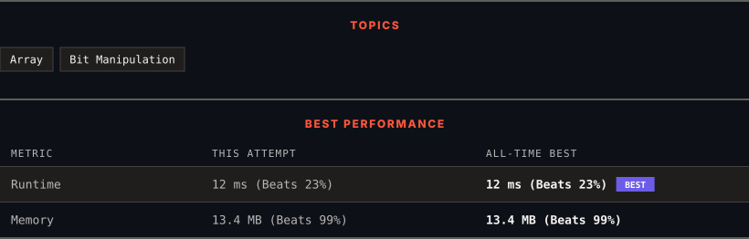

# 136. Single Number

      

---

<picture>
  <source media="(prefers-color-scheme: dark)" srcset="panel-dark.svg">
  <source media="(prefers-color-scheme: light)" srcset="panel-light.svg">
  
</picture>

> **New personal best** — Runtime improved on this submission.

### HOW IT WENT

| | |
|:--|:--|
| **Attempts** | first try |
| **Time to solve** | 7 min |
| **Verdicts** | ✅ Accepted |

---

### NOTES

_No notes yet._

---

### SOLUTIONS (1)

| # | File | Language | Date |
|:-:|------|:--------:|:----:|
| 1 | [sol1.py](./sol1.py) | `Python` | 2026-10-13 ← **latest** |

---

### PROBLEM DESCRIPTION

Given a **non-empty** array of integers `nums`, every element appears *twice* except for one. Find that single one.

You must implement a solution with a linear runtime complexity and use only constant extra space.

 

**Example 1:**

**Input:** nums = [2,2,1]

**Output:** 1

**Example 2:**

**Input:** nums = [4,1,2,1,2]

**Output:** 4

**Example 3:**

**Input:** nums = [1]

**Output:** 1

 

**Constraints:**

	- `1 <= nums.length <= 3 * 10^4`

	- `-3 * 10^4 <= nums[i] <= 3 * 10^4`

	- Each element in the array appears twice except for one element which appears only once.

---

Auto-synced by <strong>LeetSync</strong> · Built by <a href="https://deveshsamant.in/">Devesh Samant</a>

