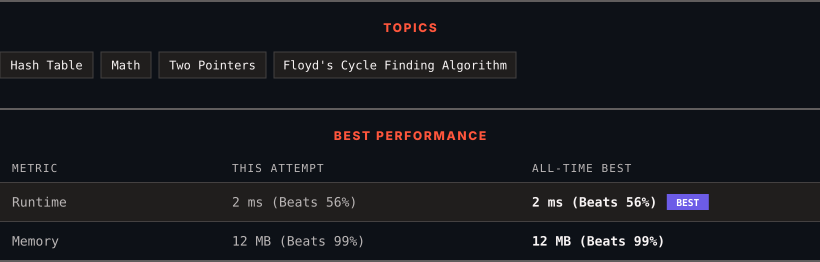

<div align="center">

# 202. Happy Number

      

[](https://leetcode.com/problems/happy-number/)

</div>

---

<div align="center">

<picture>
  <source media="(prefers-color-scheme: dark)" srcset="panel-dark.svg">
  <source media="(prefers-color-scheme: light)" srcset="panel-light.svg">
  
</picture>

</div>

> **New personal best** — Runtime improved on this submission.

### HOW IT WENT

| | |
|:--|:--|
| **Attempts** | first try |
| **Time to solve** | 1 min |
| **Verdicts** | ✅ Accepted |

---

### NOTES

_No notes yet._

---

### SOLUTIONS (1)

| # | File | Language | Date |
|:-:|------|:--------:|:----:|
| 1 | [sol1.py](./sol1.py) | `Python` | 2026-10-19 ← **latest** |

---

### PROBLEM DESCRIPTION

Write an algorithm to determine if a number `n` is happy.

A **happy number** is a number defined by the following process:

	- Starting with any positive integer, replace the number by the sum of the squares of its digits.

	- Repeat the process until the number equals 1 (where it will stay), or it **loops endlessly in a cycle** which does not include 1.

	- Those numbers for which this process **ends in 1** are happy.

Return `true` *if* `n` *is a happy number, and* `false` *if not*.

 

**Example 1:**

```

**Input:** n = 19
**Output:** true
**Explanation:**
1^2 + 9^2 = 82
8^2 + 2^2 = 68
6^2 + 8^2 = 100
1^2 + 0^2 + 0^2 = 1

```

**Example 2:**

```

**Input:** n = 2
**Output:** false

```

 

**Constraints:**

	- `1 <= n <= 2^31 - 1`

---

<div align="center">

<sub>Auto-synced by <strong>LeetSync</strong> · Built by <a href="https://deveshsamant.in/">Devesh Samant</a></sub>

</div>
